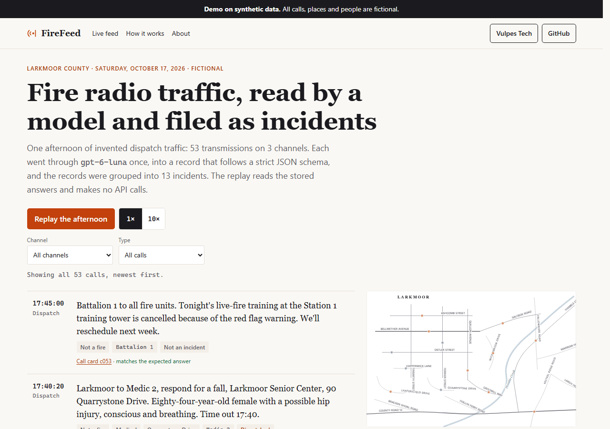
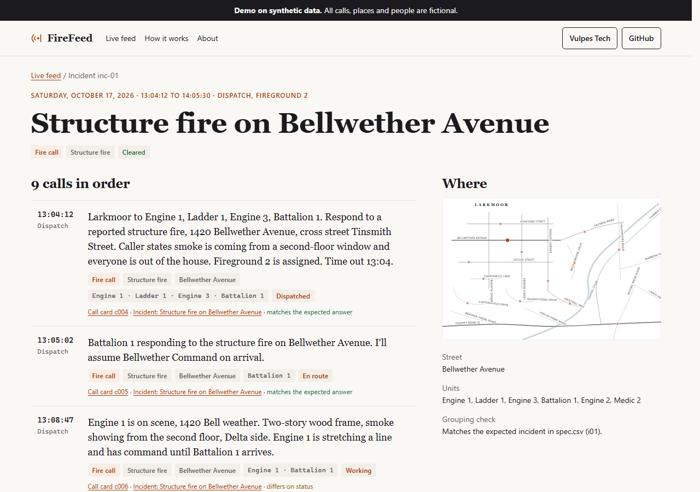
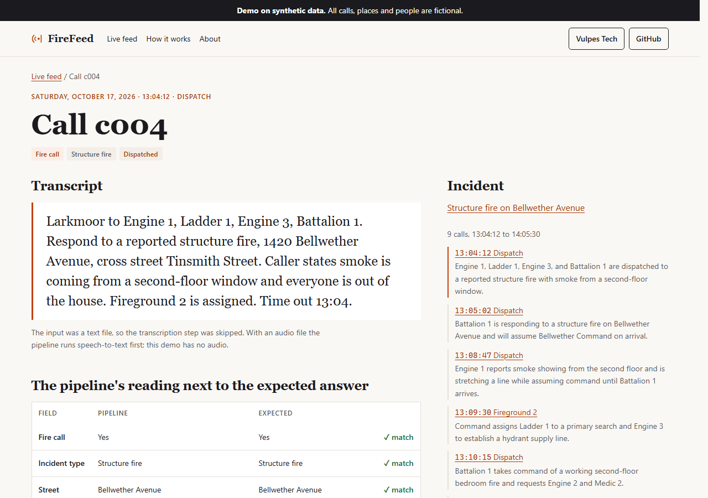

# FireFeed

> **Demo on synthetic data. All calls, places and people are fictional.**

FireFeed turns fire department radio traffic into structured incidents. Each transmission goes in as audio or a transcript and comes out as a typed record: fire or not, incident type, street, units and status. Related records are then grouped into incidents.

**Live demo: [fire-feeds.online](https://fire-feeds.online).** One invented afternoon in Larkmoor County, which does not exist: 53 calls on 3 channels, 13 incidents. The site replays stored answers and makes no API calls.



## How it works

```
calls/ (.txt or audio + .json)
  → ingest       checks every file before the first request
  → transcribe   speech-to-text; skipped when a transcript exists
  → analyze      one request per call, strict JSON schema
  → cluster      rules group related calls into incidents
  → export       feed.json
  → notify       Telegram or webhook for new fire incidents; off in the demo
```

- **Analyze.** The OpenAI Responses API answers in a strict JSON schema (Structured Outputs), and every answer, fresh or cached, is validated again before use. The model reports the street as heard; a gazetteer of known streets and units maps it to the right one, so "1420 Bell weather" lands on Bellwether Avenue.
- **Cluster.** Deterministic rules with no API calls. A dispatch to a new street opens an incident; later calls join by street, then by shared unit, then by channel within two minutes; "cleared" or "cancelled" closes it. Two different known streets never join. Details in [`src/firefeed/cluster.py`](src/firefeed/cluster.py).
- **Cache and cost guard.** Answers are cached by a hash of the model, settings, prompt, schema and input, so a repeated run makes no requests. Before a run the pipeline counts cache misses and estimates their cost. It refuses to start above the request limit and asks for `--yes` above the cost threshold.



## Results on the synthetic set

One recorded run on 2026-11-21: `gpt-6-luna`, reasoning effort `low`, prompt version `2026-11-21.1`. The numbers describe these 53 invented calls and nothing else; they say nothing about accuracy on real radio traffic.

| Field | Correct |
|---|---:|
| Fire or not | 53 of 53 |
| Incident type | 50 of 53 |
| Street | 52 of 53 |
| Units | 53 of 53 |
| Status | 50 of 53 |
| Incidents grouped exactly | 13 of 13 |

47 of the 53 calls match on every field. The expected answers were fixed before the run and not changed after it. [`data/README.md`](data/README.md) lists the six calls that differ and why some of those labels are arguable.

**Cost of that run:** 53 API requests, 55,454 input and 6,565 output tokens, $0.0088 in total or $0.00017 per call, at the Standard-tier prices in [`firefeed.toml`](firefeed.toml) (checked 2026-11-21). The demo input is text, so no transcription ran. Audio would add speech-to-text at the listed $0.0045 per minute.



## Quick start

Python 3.12. The committed answer cache covers every demo call, so this needs no API key, makes no requests and writes the same `feed.json` and `evaluation.json` that are committed.

```bash
git clone https://github.com/bohdan-mazur/firefeed.git
cd firefeed
python -m venv .venv
source .venv/bin/activate          # Windows PowerShell: .venv\Scripts\Activate.ps1
pip install -e ".[dev]" -c constraints.txt
pytest                             # no network
firefeed run --dry-run             # cache hits and misses, cost estimate
firefeed run                       # writes data/demo/out/feed.json
firefeed evaluate                  # compares with data/spec.csv, writes evaluation.json
```

## Run it on your own calls

**1. Calls.** One file per transmission in a folder: a transcript (`.txt`) or audio (`.wav`, `.mp3`, `.m4a`, `.ogg`, `.flac`, `.webm`), each with a JSON file of the same name. The timestamp needs a UTC offset.

```
calls/
  0001.wav
  0001.json      {"timestamp": "2026-10-17T13:04:12-05:00", "channel": "Dispatch"}
```

**2. Config.** Write your own file. Without `--config`, `firefeed` reads `./firefeed.toml`, which belongs to the demo: its gazetteer would match your calls against Larkmoor streets, and the output would be marked synthetic.

```toml
# my-calls.toml; paths are relative to this file
[dataset]
name = "My calls"
input_dir = "calls"
output_dir = "out"
cache_dir = ".cache"
# gazetteer = "gazetteer.json"   # optional, see below
```

Every other setting has the default shown in [`firefeed.toml`](firefeed.toml): the model, prices, grouping windows and limits. Copy a section from there to change it.

**3. Run.** Copy `.env.example` to `.env` and set `OPENAI_API_KEY`. Estimate first, then run:

```bash
firefeed run --config my-calls.toml --dry-run
firefeed run --config my-calls.toml
```

A run that needs more than 60 requests stops before the first one (raise it with `--max-requests` or `[limits]`). Above an estimate of $0.50 it stops and asks you to run again with `--yes`.

`out/feed.json` holds every call (transcript, the model's answer, matched street and units, incident id) and every incident (calls, time span, type, street, units, status, summary). Answers stay in the cache folder, so running the same calls again makes no requests.

### Gazetteer (optional)

Your streets, units and radio codes, in the shape of [`data/gazetteer.json`](data/gazetteer.json). The model gets them as local knowledge, and streets and units in its answers are matched to these names, aliases included.

```json
{
  "name": "My county",
  "streets": [{ "name": "Main Street", "aliases": ["Main St"] }],
  "units": [{ "name": "Engine 1", "station": "Station 1", "aliases": ["E1"] }],
  "channels": ["Dispatch"],
  "dispatcher": "County",
  "radio_codes": { "10-8": "back in service" }
}
```

### Accuracy on your own labels

A CSV with the expected answer per call: columns `call_id`, `incident_id`, `is_fire`, `incident_type`, `street`, `units` (separated by `;`) and `status`, with values as described in [`data/README.md`](data/README.md). Then:

```bash
firefeed evaluate --config my-calls.toml --spec my-labels.csv
```

## Limitations

- Measured only on 53 synthetic calls written for this demo. Real traffic has noise, crosstalk, clipped words and local jargon that this set does not.
- Built and measured for English: the prompt and labels are English, and speech-to-text is set to `en`.
- Calls are read one at a time. Context from earlier calls reaches a record only through grouping, so "primary search on the second floor" on its own gets the type `unknown`.
- Grouping rules were tuned on this one afternoon. A second dispatch to the same street within an hour joins the first incident unless it was already cleared; a call with no street and no unit is placed by channel and time.
- Batch only: the pipeline reads a folder. A live feed from a real radio channel needs the written permission of the channel's owner and is not part of this repository.
- Telegram and webhook alerts are implemented and tested without real requests, and switched off in the demo.

## Repository

| Path | What |
|---|---|
| `src/firefeed/` | The pipeline and the `firefeed` command |
| `tests/` | pytest, no network |
| `data/` | The synthetic dataset, expected answers, answer cache and recorded output; see [`data/README.md`](data/README.md) |
| `firefeed.toml` | The demo configuration, with comments |
| `site/` | The demo website |
| `docs/screenshots/` | Images for this README |

CI runs ruff, pytest, the cached demo run with its evaluation, the site build with a link check, and gitleaks.

## Site

`site/` is a static Next.js export that reads `data/demo/out/feed.json`, `data/demo/out/evaluation.json` and `data/map.json` at build time. No backend, no API keys. Node 24.

```bash
cd site
npm ci
npm run build          # writes site/out/
npm run check:links    # every internal link resolves; the synthetic-data notice is on every page
```

After a deploy that adds or changes pages, `npm run indexnow` sends the live sitemap of fire-feeds.online to IndexNow (Bing and the other engines of the protocol). The key is `site/public/<key>.txt`; it is public by design. `npm run indexnow -- --dry-run` checks the key on the live site and sends nothing.

## License

MIT, see [LICENSE](LICENSE). Author: Bohdan Mazur, [Vulpes Tech](https://vulpes-tech.net/ai-integrations).
